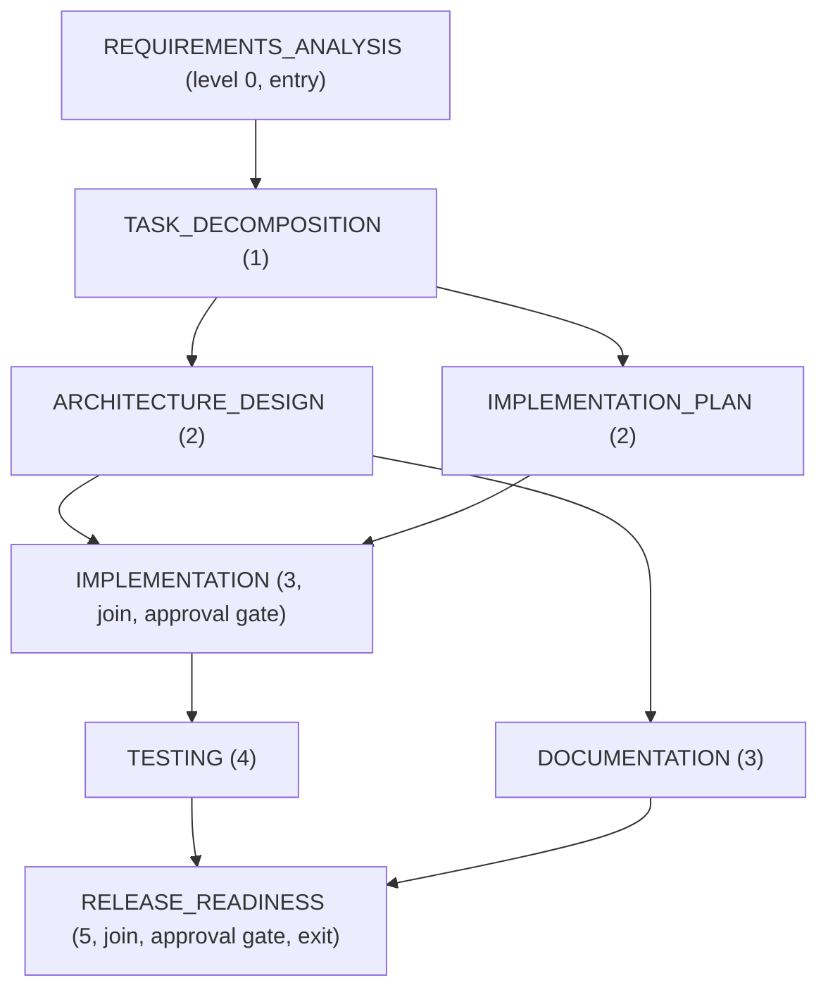
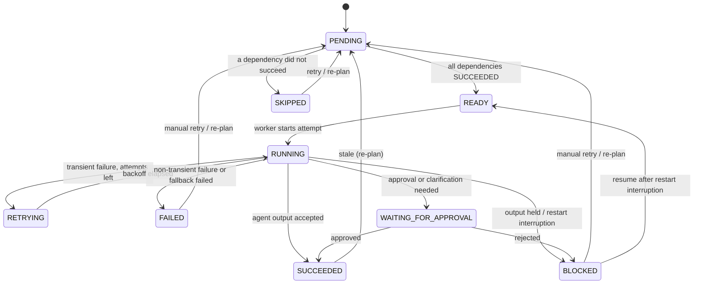
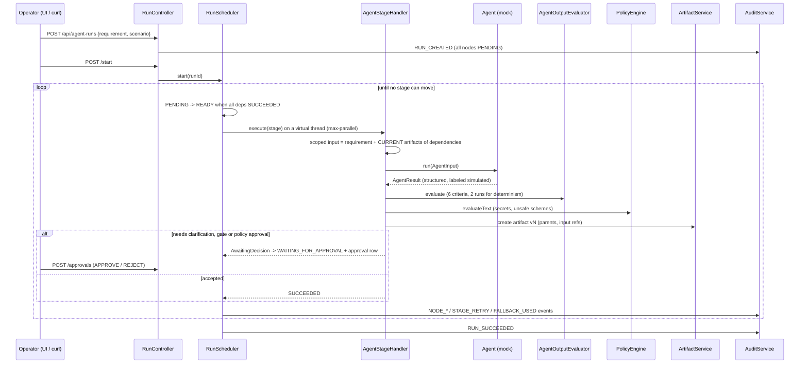
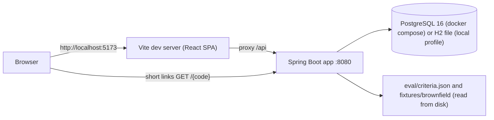

# Architecture

This document describes how the system is built and why. It covers two things that share one deployable:

1. a **URL shortener** (the sample product: create, redirect, expire, deactivate, click analytics), and
2. a **governed agentic SDLC orchestration engine** that takes a requirement through analysis, design, an implementation
   proposal, testing, documentation and release readiness, using a persisted workflow graph, deterministic mock agents,
   policy checks, human approval gates, retries, fallback, safe-stop, rollback and re-planning.

Everything below was written from the code under `backend/src/main/java/com/example/shortener/`. Where a Phase 6 piece is
still being built it is listed in [Phase 6 additions](#phase-6-additions) and not described as existing code.

## 1. Components and package boundaries

The backend is one Spring Boot 3.5 / Java 21 application (a modular monolith). The frontend is a separate React + TypeScript
(Vite) single-page app that only talks to the backend over HTTP.

| Package | Responsibility | Depends on |
|---------|----------------|------------|
| `shortener` | Link create/list/get/deactivate, URL and alias validation, short-code generation, idempotent creation, redirect. | `analytics`, `common` |
| `analytics` | Click events (sanitized), aggregate and per-link analytics. | `shortener` (entities), `common` |
| `orchestrator` | Run lifecycle, workflow graph definition and validation, node state machine, scheduler, operator controls (retry, re-plan, rollback), stage handler that executes an agent for a stage. | `agents`, `artifacts`, `audit`, `evaluation`, `governance`, `common` |
| `agents` | The agent contract (`Agent`, `AgentProvider`, `AgentInput`, `AgentResult`, `AgentStatus`) and the deterministic mock agents (`agents.mock`). | none (pure) |
| `artifacts` | Versioned stage outputs with lineage, status (CURRENT/STALE/SUPERSEDED), restore. | `common` |
| `audit` | Append-only audit events and their read API. | `common` |
| `governance` | Policy engine, approval records and rules, demo actor resolution, retry policy bean. | `orchestrator`, `artifacts`, `audit`, `common` |
| `evaluation` | Rule-based scoring of an agent output against six versioned criteria (`eval/criteria.json`). | `agents` |
| `common` | Error model (`ApiError`, `ApiException`, `GlobalExceptionHandler`), request-id filter, in-memory rate limiter, OpenAPI config. | none |

Notes on the boundaries:

* `agents` and `evaluation` know nothing about persistence, HTTP or the scheduler. An agent receives an immutable
  `AgentInput` and returns an immutable `AgentResult`. That is what makes the mock provider swappable.
* Only `RunTransitions` changes a node's status. Nothing else writes `run_node.status`.
* `governance` and `orchestrator` reference each other (the approval service calls the run-control service, and the
  scheduler creates approval rows). This is a known cycle at package level, kept because both are small.
* The frontend (`frontend/src`) is layered as `api/` (typed fetch clients), `hooks/` (polling), `components/` and `pages/`
  (Shorten, Runs, Approvals, Artifacts). It polls the run while it is `RUNNING` or `WAITING_FOR_APPROVAL`.

## 2. The persisted workflow graph

A workflow is a `WorkflowDefinition` (a name plus a list of `NodeDef`). Each `NodeDef` has an `id`, a display name, a list of
`dependsOn` node ids and a `requiresApproval` flag. The only registered workflow is `greenfield-sdlc`
(`DefaultWorkflow`); Brownfield and Ambiguous runs use the same graph and differ only in what the agents produce.

When a run is created, the definition is validated (`GraphValidator`: no blank or duplicate ids, no unknown or self
dependencies, no cycles) and then **copied into the database**: one `agent_run` row and one `run_node` row per node, with
`depends_on` stored as a comma-separated list. After that the scheduler reads the persisted rows, not the code definition,
so run state survives a restart.

| Node | Depends on | Level | Artifact type | Notes |
|------|-----------|-------|---------------|-------|
| `REQUIREMENTS_ANALYSIS` | none | 0 | `REQUIREMENT` | Entry node. Can ask for clarification (Ambiguous). |
| `TASK_DECOMPOSITION` | REQUIREMENTS_ANALYSIS | 1 | `TASK_PLAN` | |
| `ARCHITECTURE_DESIGN` | TASK_DECOMPOSITION | 2 | `DESIGN` | Runs in parallel with IMPLEMENTATION_PLAN. |
| `IMPLEMENTATION_PLAN` | TASK_DECOMPOSITION | 2 | `IMPLEMENTATION_PLAN` | |
| `IMPLEMENTATION` | ARCHITECTURE_DESIGN, IMPLEMENTATION_PLAN | 3 | `CODE_PROPOSAL` | **Join** and **approval gate** (`requiresApproval`). |
| `TESTING` | IMPLEMENTATION | 4 | `TEST_REPORT` | |
| `DOCUMENTATION` | ARCHITECTURE_DESIGN | 3 | `DOCUMENTATION` | Runs alongside IMPLEMENTATION and TESTING. |
| `RELEASE_READINESS` | TESTING, DOCUMENTATION | 5 | `RELEASE_CHECKLIST` | **Join**, **approval gate**, exit node. |

Definitions used throughout:

* **Level** is the length of the longest dependency path from an entry node (`GraphValidator.levels`). It is returned in the
  run detail so the UI can lay stages out in columns; nodes at the same level are candidates to run concurrently.
* **Entry nodes** are nodes with an empty `dependsOn`; **exit nodes** are nodes nothing depends on. Both are derived from the
  dependencies and are not stored.
* A **join** is any node with more than one dependency; it becomes ready only when all of them succeeded.
* An **approval gate** is a node with `requires_approval = true`. In addition, the policy engine can require approval for a
  node whose output represents a high-impact action (section 8), and an agent can ask for clarification.

## 3. Node state machine

`NodeStateMachine` is a pure table of legal transitions. `RunTransitions.move(...)` is the only caller that changes status;
it checks the table, saves the node, inserts a `node_transition` history row and appends a `NODE_<STATUS>` audit event in one
transaction. An illegal move throws `IllegalTransitionException` and changes nothing.

Statuses: `PENDING, READY, RUNNING, SUCCEEDED, FAILED, BLOCKED, WAITING_FOR_APPROVAL, RETRYING, CANCELLED, SKIPPED`.
Terminal for run-completion purposes: `SUCCEEDED, FAILED, CANCELLED, SKIPPED` (note that `BLOCKED` and
`WAITING_FOR_APPROVAL` are not terminal: they need a human).

### Transition table

| From | Allowed next states | Typical cause |
|------|---------------------|---------------|
| `PENDING` | `READY`, `BLOCKED`, `SKIPPED`, `CANCELLED` | READY when every dependency SUCCEEDED; SKIPPED when a dependency FAILED, was CANCELLED or SKIPPED. |
| `READY` | `RUNNING`, `BLOCKED`, `SKIPPED`, `CANCELLED` | A scheduler worker picks it up. |
| `RUNNING` | `SUCCEEDED`, `FAILED`, `RETRYING`, `WAITING_FOR_APPROVAL`, `BLOCKED`, `CANCELLED` | Agent finished; transient failure; approval or clarification needed; output held for review. |
| `RETRYING` | `RUNNING`, `FAILED`, `CANCELLED` | Backoff elapsed and the next attempt starts. |
| `WAITING_FOR_APPROVAL` | `SUCCEEDED`, `BLOCKED`, `PENDING`, `CANCELLED` | Approved; rejected (BLOCKED); re-queued by a re-plan (PENDING). |
| `BLOCKED` | `READY`, `SKIPPED`, `PENDING`, `CANCELLED` | READY on resume after an interrupted run; PENDING on manual retry or re-plan. |
| `FAILED` | `RETRYING`, `PENDING`, `CANCELLED` | PENDING on manual retry or re-plan. |
| `SUCCEEDED` | `PENDING` | Only when an upstream change makes the result stale (re-plan). |
| `SKIPPED` | `PENDING` | Re-queued by a retry or re-plan that makes it runnable again. |
| `CANCELLED` | none | Declared and legal in the table, but no API in this build cancels a stage. |

Run-level status is separate (`RunStatus`): `CREATED, RUNNING, PAUSED, WAITING_FOR_APPROVAL, SUCCEEDED, FAILED, CANCELLED`
(`CANCELLED` exists in the enum but nothing sets it).

## 4. The scheduler

`RunScheduler` is a dependency-driven scheduler running inside the application process.

**Readiness rule.** After every state change the scheduler re-evaluates the run. A `PENDING` node becomes `READY` only when
**every** dependency is `SUCCEEDED`. If **any** dependency is `FAILED`, `CANCELLED` or `SKIPPED`, the node becomes
`SKIPPED`. This repeats until nothing changes, so a failure cascades down the graph in one pass.

**Bounded concurrency.** Ready nodes are submitted to a virtual-thread-per-task executor. A `Semaphore` sized by
`shortener.orchestrator.max-parallel` (default 4) caps how many stages execute at once. A set of queued node ids prevents
double submission.

**Locks.** Every scheduling decision and every operator action (start, pause, retry, re-plan, rollback, approval
resolution) runs under a per-run monitor (`Map<runId, Object>` in the JVM). The agent call itself runs *outside* the lock so
parallel branches really overlap; only the status changes are serialized.

**Per-stage execution (`runNode`).**

1. Take a permit, then under the lock check the run is still `RUNNING` (otherwise the node stays `READY`), move the node to
   `RUNNING` and increment `attempt_count`.
2. Insert a `stage_attempt` row and call the stage handler.
3. On a transient failure, retry up to `max-attempts` with capped exponential backoff (see section 7), moving
   `RUNNING -> RETRYING -> RUNNING` and writing a `STAGE_RETRY` audit event each time.
4. If retries are exhausted and the handler supports it, run the deterministic fallback once (`FALLBACK_USED`).
5. Apply the outcome: `SUCCEEDED`, `WAITING_FOR_APPROVAL` (plus an `approval` row and `APPROVAL_REQUESTED`), `BLOCKED` with
   error code `HELD` (output held for review), or `FAILED`.
6. Re-run the scheduling pass.

**Run completion.** When every node is terminal the run becomes `SUCCEEDED`, or `FAILED` if any node `FAILED`. If nothing is
running, ready or retrying and at least one node is `WAITING_FOR_APPROVAL` or `BLOCKED`, the run becomes
`WAITING_FOR_APPROVAL` (a human is needed).

**Pause (safe-stop).** `POST .../pause` moves a `RUNNING` run to `PAUSED`. No new stage starts; stages already executing
finish (including a retry loop that is already in progress). Nodes that were `READY` stay `READY` and resume on the next
`start`. Pausing a run that is not `RUNNING` returns 409.

**Restart recovery.** On `ApplicationReadyEvent`, every run still marked `RUNNING` is assumed interrupted, because no stage can
really be running after a restart. Its `RUNNING`/`RETRYING` nodes become `BLOCKED` with error code `INTERRUPTED`, and the run
becomes `PAUSED`. An operator calls `start`, which moves the interrupted nodes to `READY` and continues. Nothing is silently
re-executed.

## 5. Control flow of one run

Key properties of the handler (`AgentStageHandler`):

* **Scoped context.** An agent only sees the raw and normalized requirement, the scenario, the `structuredOutput` of the
  `CURRENT` artifacts of the stage's own dependencies, and three policy constraint labels. It never sees other stages.
* **Nothing unsafe is stored.** Evaluation and the policy text check run *before* the artifact is created. A failure raises
  `HeldForReviewException`: the node goes `BLOCKED` (`HELD`), no artifact is stored and nothing downstream can consume it.
  An operator can retry the stage.
* **The agent never decides approvals.** After storing the artifact the handler throws `AwaitingDecisionException` when the
  agent asked for clarification, when the node has `requires_approval`, or when the policy decision for the stage is not
  `ALLOW`. The scheduler turns that into `WAITING_FOR_APPROVAL`.

## 6. Agents and the provider abstraction

Every agent implements `Agent` (`name()`, `stageId()`, `run(AgentInput)`) and returns an `AgentResult` with: `agentName`,
`status` (`SUCCESS`, `NEEDS_CLARIFICATION`, `FAILED`, `FALLBACK`), `summary`, `structuredOutput` (stage-specific map),
`assumptions`, `risks`, `openQuestions`, `recommendedNextActions`, `confidence` (0 to 1) with `confidenceNote`,
`referencesToInputs` and `simulated`. An `AgentProvider` maps a stage id to its agent (`forStage`) and names itself
(`providerName`).

| Stage | Mock agent |
|-------|-----------|
| REQUIREMENTS_ANALYSIS | `RequirementsAnalystAgent` (also does the Brownfield fixture analysis and the Ambiguous clarification) |
| TASK_DECOMPOSITION | `PlannerAgent` |
| ARCHITECTURE_DESIGN | `ArchitectAgent` |
| IMPLEMENTATION_PLAN | `ImplementationPlanAgent` |
| IMPLEMENTATION | `ImplementerAgent` (a text diff; `applied` is always `false`) |
| TESTING | `TestAgent` (plan plus simulated expected results; nothing is executed) |
| DOCUMENTATION | `DocumentationAgent` |
| RELEASE_READINESS | `ReleaseReadinessAgent` |

**Mock provider (default).** `MockAgentProvider` is deterministic: no clocks, randomness or unordered iteration, so the same
input gives identical output (the evaluator checks this). Every summary starts with `[SIMULATED]` and `simulated=true`.
`shortener.agents.provider` defaults to `mock`; in the current code any other value fails startup with a clear message
(`AgentsConfig`). The optional env-configured provider is a Phase 6 deliverable (see below).

**Fallback.** `AgentStageHandler` owns a second, always-available `MockAgentProvider`. When the primary provider keeps
failing with a transient error and retries are exhausted, the scheduler calls `executeFallback`, which produces the output
from the mock provider with status `FALLBACK` and `simulated=true`. The attempt row records `provider_used` as
`<provider>-fallback` and `fallback_used = true`, and the audit trail records `FALLBACK_USED`. With the default mock provider
the "primary" and the fallback are the same deterministic code; the fallback path is exercised through
`FailureInjector` (`shortener.orchestrator.inject-failures=TESTING:3`), which throws `TransientFailureException` for the
first N attempts of a stage per run.

## 7. Policy and approval flow

**Policy engine** (`PolicyEngine`, version `1.0`) is deterministic and has no I/O.

| Check | Rule | Outcome |
|-------|------|---------|
| Text in a stored output | `no-embedded-secrets` (GitHub token, cloud access key, private key block, credential-like assignment) | `DENY` |
| Text in a stored output | `no-unsafe-url-schemes` (`javascript:`, `vbscript:`, `data:text/html`, `file://`) | `DENY` |
| Action `APPLY_PATCH` | `generated-output-is-proposal` | `REQUIRE_APPROVAL` |
| Action `RELEASE_READINESS` | `release-readiness-requires-approval`; with failing tests `failing-tests-block-release` | `REQUIRE_APPROVAL`; `DENY` when tests failed and no override |
| Action `RUN_COMMAND` | destructive tokens (`rm -rf`, `drop table`, ...) denied, others need approval | `DENY` / `REQUIRE_APPROVAL` |
| Action `DESTRUCTIVE_DB` | non-test data needs approval | `REQUIRE_APPROVAL` / `ALLOW` |
| Action `DEPLOY_PRODUCTION` | `no-production-deployment` | `DENY` |

Which checks the orchestrator actually invokes today: the text checks on every stage output; the `APPLY_PATCH` action on
`IMPLEMENTATION`; the `RELEASE_READINESS` action on `RELEASE_READINESS` (counting `expectedResults.failed` from the TESTING
artifact). The command, database and deployment rules are implemented and unit tested in the engine but no stage currently
proposes those actions, because nothing in this system executes commands or deploys. Decisions other than the plain text
`ALLOW` are saved to `policy_decision` and mirrored as `POLICY_*` audit events.

A `DENY` on the release action is not terminal: it is raised as an approval request carrying the rule
`failing-tests-block-release`; approving it writes `RELEASE_OVERRIDE_APPROVED` to the audit trail and a policy-decision row,
so an override is explicit and traceable. The mock `TestAgent` always reports zero failures, so this path is covered by
unit tests but is not reachable in a demo run.

**Approvals** (`ApprovalService`). A pending `approval` row (kind `CLARIFICATION`, `HIGH_IMPACT_ACTION` or `HELD_OUTPUT`)
is created when a stage enters `WAITING_FOR_APPROVAL`. A decision is `APPROVE` or `REJECT` with a comment (mandatory on
reject). Rules enforced before anything changes:

* the actor comes from the `X-Demo-User` header (default `demo-user`); an id starting with `agent:` is an `AGENT` and gets
  403 `APPROVAL_FORBIDDEN`; the artifact's own author (compared with the artifact's `created_by`) also gets 403;
* if the caller passes `artifactVersion` and it is no longer the current version, the answer is 409 `STALE_APPROVAL`;
* a decision is recorded once with approver, timestamp, comment, artifact version and policy reason, and is never edited.

Approve moves the stage to `SUCCEEDED` and continues the run. Reject moves it to `BLOCKED` (`REJECTED`) and records the
feedback; the operator then re-queues it with the retry endpoint, which regenerates the stage as a new artifact version and
opens a fresh approval. Pending approvals of stages that get re-planned are marked `SUPERSEDED`.

## 8. Artifacts: versioning, lineage, stale propagation, rollback

An `artifact` row belongs to `(run, node, type)` and carries a `version` (1, 2, 3, ...), the full JSON `content` (the
serialized `AgentResult`), a SHA-256 `checksum`, `status`, `parent_artifact_ids` (database ids of the exact upstream
artifact rows that were the input), `input_refs` (the agent's `referencesToInputs`), `created_by` (the agent name) and
`created_at`. `(run_id, node_id, artifact_type, version)` is unique.

| Status | Meaning |
|--------|---------|
| `CURRENT` | The version downstream stages read. At most one per (run, node, type). |
| `SUPERSEDED` | Replaced by a newer version; restorable. |
| `STALE` | Its inputs changed in a re-plan; never read by later stages and not restorable (it must be regenerated). |

* **Lineage.** `parent_artifact_ids` is the authoritative lineage (real row ids). `input_refs` is what the agent reported as
  `STAGE:v1` references; the mock agents always write `v1`, so treat it as a readable label, not as the exact version.
* **Stale propagation.** `DownstreamClosure` computes a changed stage plus everything that transitively depends on it. A
  re-plan marks the `CURRENT` artifact of each stage in that set `STALE`, moves those nodes back to `PENDING` (and
  supersedes their pending approvals), bumps `plan_version` and writes `RUN_REPLANNED`. Stages outside the set keep their
  results and are not re-run. A re-plan is refused with 409 `REPLAN_REQUIRES_PAUSE` while an affected stage is `RUNNING`,
  `RETRYING` or `READY`.
* **Rollback.** `POST .../rollback` makes a prior version `CURRENT` again and the version that was current `SUPERSEDED`.
  Nothing is deleted or rewritten, and `ARTIFACT_ROLLBACK` is appended to the audit trail. A `STALE` version is refused
  (409 `ARTIFACT_STALE`), an unknown version is 404, and restoring the current version is a no-op. Rollback is
  **artifact-level only**: it does not change node status or downstream artifacts (re-plan to refresh them), and "rolling
  back code" is simulated because the system never applies code.

## 9. Audit trail

`audit_event` rows are written through `AuditService.append` with `run_id`, `actor_type` (`HUMAN`, `AGENT`, `SYSTEM`),
`actor_id`, `event_type`, `occurred_at`, `details` (truncated to 4000 characters) and a `correlation_id` taken from the
request's `X-Request-Id` (via the logging MDC) when there is one. Entity columns are `updatable = false`, there is no update
or delete code path and the API is read-only (`GET /api/agent-runs/{id}/events`, ascending by id, paged).

Events cover run lifecycle (`RUN_CREATED`, `RUN_STARTED`, `RUN_PAUSED`, `RUN_WAITING_FOR_APPROVAL`, `RUN_SUCCEEDED`,
`RUN_FAILED`, `RUN_REPLANNED`), every node transition (`NODE_<STATUS>` with `from -> to (reason)`), `STAGE_RETRY`,
`FALLBACK_USED`, `NODE_RETRY_REQUESTED`, `ARTIFACT_CREATED`, `ARTIFACT_ROLLBACK`, `OUTPUT_FLAGGED`, `POLICY_*`,
`CLARIFICATION_NEEDED`, `APPROVAL_REQUESTED`, `APPROVAL_APPROVED`, `APPROVAL_REJECTED` and `RELEASE_OVERRIDE_APPROVED`. The
"append-only" property is a code convention, not a database guarantee (see risks).

## 10. Evaluation criteria

`AgentOutputEvaluator` scores every output on six criteria loaded from `eval/criteria.json` (version `1.0`, pass threshold
1.0, so **all** must pass). It is rule-based, not an LLM judge.

| Criterion | What it checks |
|-----------|----------------|
| `schema_valid` | Contract fields present; confidence within [0,1]; a confidence note when confidence is below 0.7. |
| `stage_complete` | Required `structuredOutput` keys for the stage; clarification needs open questions; `IMPLEMENTATION.applied` must not be true; Ambiguous analysis needs questions and assumptions. |
| `upstream_consistent` | `referencesToInputs` are well-formed (`STAGE:vN`) and only point at stages that were supplied as input. |
| `no_unsafe_content` | No secrets, unsafe URL schemes, destructive commands or production deploy actions in any field. |
| `labeled_simulated` | Simulated output starts with `[SIMULATED]`; `FALLBACK` output is marked simulated. |
| `deterministic` | A second run with the same input is identical. |

At run time the handler evaluates each stage output (running the agent a second time for the determinism check). The
fixtures in `eval/greenfield.json`, `brownfield.json`, `ambiguous.json` (all expected to pass) and `degraded.json` (each
expected to fail a named criterion) are replayed by the evaluation gate; results are written to `docs/evals/`.

## 11. Data model

Flyway migrations in `backend/src/main/resources/db/migration/`. Hibernate runs with `ddl-auto: validate`.

| Migration | Tables | Purpose |
|-----------|--------|---------|
| `V1__short_link.sql` | `short_link` | `code` (unique), `original_url`, `status`, `created_at`, `expires_at`, `owner`. |
| `V2__click_idempotency.sql` | `click_event`, `idempotency_record` | Sanitized clicks with FK to the link; idempotency keys (unique) with request fingerprint and 24 h expiry. |
| `V3__orchestration.sql` | `agent_run`, `run_node`, `node_transition` | Run (workflow name, scenario, raw and normalized requirement, status, `plan_version`), per-run nodes (status, attempts, `depends_on`, `requires_approval`, error fields; unique per run and node id), insert-only transition history. |
| `V4__artifacts_audit.sql` | `artifact`, `audit_event`, `stage_attempt` | Versioned artifacts, audit events, per-attempt records (`provider_used`, `fallback_used`, error). |
| `V5__governance.sql` | `approval`, `policy_decision` | Approval decisions and recorded policy outcomes (with `policy_version`). |

Orchestration tables have foreign keys within V3; the artifact, audit and governance tables use plain `run_id` columns with no
foreign keys so history cannot be removed by cascading deletes.

## 12. Security model

What exists:

* **URL safety.** Only absolute `http`/`https` URLs with ASCII hosts, no embedded credentials, no whitespace or control
  characters; max 2048 characters. The redirect only ever uses the stored, validated URL.
* **Aliases** `[A-Za-z0-9_-]{3,32}`, with reserved words rejected.
* **Click privacy.** User agent is stripped of control characters and truncated to 200; the referrer is reduced to its origin.
  No IP address is stored.
* **Rate limiting.** In-memory token bucket per TCP peer address (30 creates per minute, 120 analytics reads per minute by
  default). `X-Forwarded-For` is deliberately not trusted.
* **Errors** never include stack traces or internal messages; every response carries `X-Request-Id`.
* **Agent safety.** Generated output is a proposal; nothing is applied, executed or deployed; output is scanned for secrets
  and unsafe schemes before storage.

What is **not** authenticated or authorized:

* There is no login and no Spring Security. Every endpoint, including run control and approvals, is open to anyone who can
  reach the port.
* Approver identity is the self-declared `X-Demo-User` header, which any caller can forge. It enforces "agents and authors
  cannot approve" only against honest clients; it is demo-grade identity, not authentication.
* There is no CORS configuration; the dev UI reaches the API through the Vite proxy.

## 13. Key decisions and rejected alternatives

| Decision | Why | Alternatives rejected |
|----------|-----|-----------------------|
| Persist the graph and node state in relational tables. | Progress is observable, restart-recoverable and queryable with plain SQL; the plan asked for normalized core state. | Hard-coded call sequence (not a graph, not recoverable); full event sourcing (too heavy for the scope). |
| One status-change choke point (`RunTransitions`) over a pure transition table. | The table is unit-testable without a database, and history plus audit are written in the same transaction as the change. | Setting status directly in services (history can drift). |
| In-process scheduler with a per-run lock, semaphore and virtual threads. | Simple, explainable, bounded concurrency with little code. | Message queue or distributed job runner (operational weight, nothing to gain at one instance); Quartz (not needed). |
| Deterministic mock agents behind an `AgentProvider` interface, plus fallback to the same mocks. | Demo needs no API key and is repeatable; the contract and evaluator still apply to a future real provider. | Calling an LLM by default (non-deterministic, needs credentials). |
| Evaluate and policy-check output *before* storing it. | An unsafe or malformed output never becomes `CURRENT` and cannot leak downstream. | Store then flag (downstream could consume it). |
| Re-plan = stale the downstream closure and re-queue only that set. | Matches the "re-run only affected stages" requirement; keeps old versions and history. | Re-run the whole workflow (wasteful, loses the stale-vs-current distinction). |
| Rollback restores an artifact version, nothing else. | Honest about what can be undone when no code is ever applied. | Simulating a git/deploy rollback (would imply capabilities that do not exist). |
| Retry only transient failures; never retry validation or policy failures. | Retrying a deterministic failure cannot succeed and hides the cause. | Retry everything. |
| Approval rejection BLOCKS the stage; recovery is an explicit retry. | Forces a recorded human decision and a new artifact version per attempt. | Auto-regenerate after rejection. |
| Demo-header identity. | Keeps the prototype runnable in one command while still modelling "who approved". | Real auth (OAuth or Spring Security) was explicitly out of scope. |
| H2 file database `local` profile next to PostgreSQL. | Run without Docker for demos and reviewers. | PostgreSQL only (blocks anyone without Docker). |

## 14. Deployment and run topology

* One backend process and one database. `docker-compose.yml` starts only PostgreSQL 16; the app and the UI are started with
  `mvn spring-boot:run` and `npm run dev` (README has the commands).
* Configuration is environment based (`DB_URL`, `DB_USER`, `DB_PASSWORD`, `PUBLIC_BASE_URL`, `AGENT_PROVIDER`; see
  `.env.example`). No secrets are committed.
* The agents read `eval/criteria.json` and `fixtures/brownfield` by walking up from the working directory, so the backend must
  be started inside the repository.
* There is no production deployment, container image for the app, or cloud provisioning by design.
* Health: `GET /actuator/health` (liveness and readiness probes enabled). API docs: `/v3/api-docs` and `/swagger-ui.html`.

## Phase 6 additions

These are Phase 6 deliverables built alongside this documentation. They are described here as part of the Phase 6 scope and
should be verified against the merged code and OpenAPI document before relying on them.

* **Metrics.** `GET /api/metrics` (overall) and `GET /api/agent-runs/{id}/metrics` (one run) report success rate, retry count,
  rollback count, fallback count, end-to-end duration, per-stage latency, failed and blocked counts and mean time to
  recovery (MTTR). They are derived from the existing `agent_run`, `run_node`, `stage_attempt`, `node_transition` and
  `audit_event` data; no new write path is needed.
* **Engineering summary.** `GET /api/agent-runs/{id}/summary` returns a markdown engineering summary of a run (plan,
  artifacts, assumptions, risks, validation results, limitations).
* **Scenario presets.** `GET /api/scenarios` lists the Greenfield, Brownfield and Ambiguous presets, and a run can be created
  with only a `scenario` (the preset supplies the requirement text).
* **Optional LLM provider.** A provider selected by environment (`AGENT_PROVIDER`, `LLM_API_KEY`, `LLM_ENDPOINT`) behind the
  existing `AgentProvider` interface. It must satisfy the same `AgentResult` contract and evaluation, and it cannot bypass the
  scheduler, policy engine or approvals. If it is unavailable the mock fallback applies. Demo mode never needs it.

## Phase 7 additions: gates, safe-stop, change detection and change control

- **Entry and exit gates (`StageGates`).** Before a stage runs, its entry gate checks that every prerequisite succeeded and (for agent stages) has a
  CURRENT, non-stale artifact. After it runs, the exit gate checks that the output was stored, passed evaluation and passed policy. Each result is an
  audit event (`GATE_ENTRY_PASSED/FAILED`, `GATE_EXIT_PASSED/FAILED`) and appears in the run detail as `gates` per stage. A failed entry gate skips the stage
  and fails the run; a failed exit gate fails the stage.
- **Cooperative safe-stop.** `StageExecution.cancelled()` turns true when the run is paused. The agent handler checks it at the start and just before it stores
  output; on cancellation it throws `StageInterruptedException` and the node moves RUNNING -> READY (attempt recorded as INTERRUPTED, no retry, nothing stored).
  Resume runs it again exactly once.
- **Automatic re-plan (`ChangeDetectionService`).** A human edit of an artifact (`PUT /api/agent-runs/{id}/artifacts`) or a rollback to a different version
  triggers `autoReplan`: downstream artifacts become STALE, downstream stages are re-queued, the plan version is incremented, approval gates apply again, and an
  `AUTO_REPLAN` audit event records the lineage. If downstream stages are running, the run is paused, the stages finish, then it re-plans and resumes (15 s limit).
- **Change control.** Every approval carries a change record (risk class, change ticket, justification, proposed commands and migrations). Approving a HIGH-risk
  change needs a ticket such as `CHG-1042` and a justification. The policy engine now evaluates the commands and migrations a stage actually proposes
  (destructive commands and production deployments are denied and the output held).
- **Requirement and code analysis.** `RequirementAnalysis` derives goals, constraints and ambiguity (vague terms, missing criteria, undefined references) from the
  text; `BrownfieldAnalyzer` builds a class/endpoint/table graph from a source directory (`shortener.brownfield.path`, default the seeded fixture).
- **Verification.** Playwright journeys run in a real browser against the real backend and frontend; PostgreSQL was exercised through Docker.
